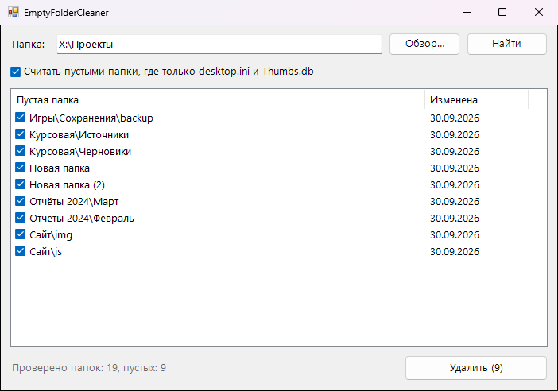

<div align="center">

# 🧹 EmptyFolderCleaner

**Находит и удаляет пустые папки, которые остались после программ, архивов и переездов**




</div>

## ✨ Возможности

- 🌳 Проверяет вложенность: папка, в которой только пустые подпапки, тоже считается пустой
- 🎯 Показывает только верхний уровень. Удалишь `Новая папка (2)`, и всё пустое внутри уйдёт вместе с ней
- 🧾 По желанию не считает содержимым служебные `desktop.ini` и `Thumbs.db`
- 🗑️ Удаляет в корзину. Прямо перед удалением ещё раз проверяет, что папка всё ещё пуста
- 🛡️ Не трогает корень диска, папку Windows, системные папки и ссылки (junction)
- 📂 Двойной клик открывает папку. Путь можно передать в аргументах: `EmptyFolderCleaner.exe "D:\Проекты"`

## 💡 Когда пригодится

- Распаковал и удалил кучу архивов, остались пустые каталоги
- В «Документах» годами копились «Новая папка (5)»
- После удаления игр и программ остались пустые папки с их названиями

## 📥 Установка

1. Скачай `EmptyFolderCleaner.exe` из раздела [**Releases**](../../releases/latest)
2. Запусти его, установка не нужна

## 🛠️ Сборка из исходников

Нужен только Windows: компилятор C# входит в состав .NET Framework.

```bat
build.bat
```

## 📄 Лицензия

[MIT](LICENSE)
